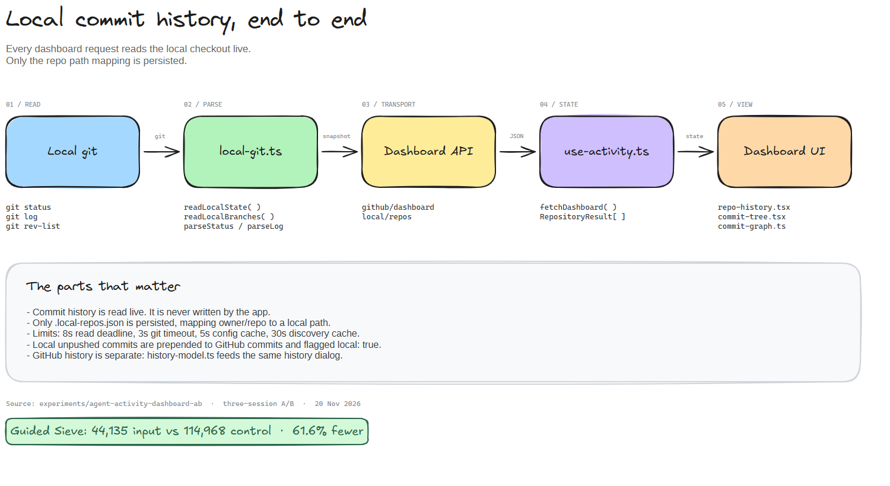
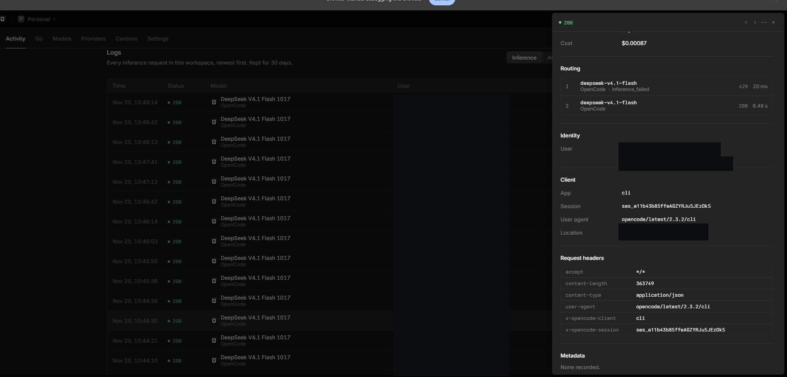
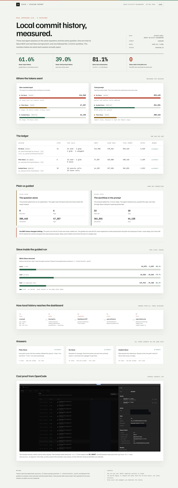

# Agent dashboard session A/B

Real OpenCode sessions on [agent-activity-dashboard](https://github.com/Jayesh-2404/agent-activity-dashboard) at commit `618610d`. Same model and prompt. One arm had no Sieve MCP, one had Sieve but never used it, and one followed the `/sieve` workflow.

*Editable source: [local-history-flow.excalidraw](local-history-flow.excalidraw)*

## Setup

- Model: `opencode-go/kimi-k2.7-code`
- Prompt: "Walk me through how this app handles local commit history. I want to know which files and functions read commits and branches from a local git repository, how that data is modeled, and how it shows up in the dashboard UI. Give exact file paths and symbol names."
- Control directory: Sieve disabled in project config.
- Sieve directory: global MCP enabled.
- Guided directory: same MCP, prompt includes the `/sieve` steps.

## Results

| Session | Sieve calls | Steps | Input | Cache read | Total prompt | Output | Answer |
|---|---:|---:|---:|---:|---:|---:|---|
| No Sieve, control | 0 | 12 | 114,968 | 478,464 | 593,432 | 6,915 | Correct |
| Plain Sieve | 0 | 6 | 47,357 | 153,088 | 200,445 | 2,269 | Correct |
| Guided Sieve | 23 | 10 | 44,135 | 317,696 | 361,831 | 2,512 | Correct |

The control row is the parent session plus its `explore` child session.

Guided Sieve used 61.6% fewer non-cached input tokens than the control and 39.0% fewer total prompt tokens. The plain Sieve run was still the cheapest at 200,445 total prompt, because it took 6 steps and never called Sieve.

## Cost proof from OpenCode Console

The OpenCode Console records a dollar cost for every inference request. The captured request is a Console-routed `deepseek-v4.1-flash` call at `$0.00087`. The A/B sessions used `opencode-go/kimi-k2.7-code`, and `session_v2` reports cost `0.0` for them, so this image proves the Console's cost surface, not the A/B total. Personal identifiers are redacted.

## Plain vs guided

The connection was identical. Plain Sieve only got the question and used native reads. Guided Sieve got the workflow and made 23 Sieve calls. The extra steps made guided 80.5% more expensive in total prompt than plain, while still 39.0% below the control. The MCP alone changed nothing.

## What the app does

Local commit history is read live from the checkout on each dashboard request. `src/lib/local-git.ts` runs `git status`, `git log`, and `git rev-list`. `readLocalState`, `readLocalBranches`, `parseStatus`, and `parseLog` build the snapshot. Only `.local-repos.json` is persisted. The dashboard route attaches the snapshot, `use-activity.ts` stores it, and `repo-history.tsx`, `commit-tree.tsx`, and `commit-graph.ts` render it.

## Dashboard

[Open the dashboard](dashboard.html). It is a single self-contained HTML file with light and dark mode, token charts, the full ledger, session IDs, and the flow diagram.

## Files

- `dashboard.html`
- `local-history-flow.excalidraw`
- `local-history-flow.png`
- `dashboard-preview.png`
- `opencode-console-cost.png`

## Caveats

One run per arm. Model sampling variance is large. The control used an `explore` subagent, which inflates its total. Cost reported `0.0` for every session, so dollars are not compared. The 86.9% figure in `compact.md` comes from the no-tool context bench, not these sessions.
